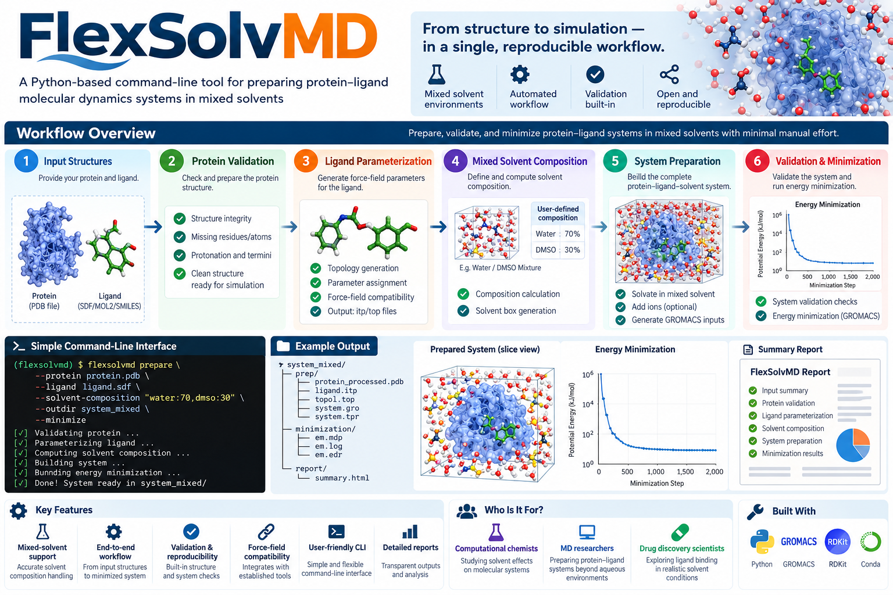

# FlexSolvMD

  

A terminal-based Python tool for preparing mixed-solvent
molecular dynamics systems and performing energy minimization.

The workflow ends after minimization; it does not automatically
start NVT, NPT, or production molecular dynamics.

## Initial capabilities

- Interactive GROMACS version selection
- Executable version verification
- Separate Python environment
- Central GROMACS configuration

## Planned capabilities

- Protein and ligand input validation
- Force-field compatibility checks
- Water-DMSO composition calculations
- Solvent-box construction and topology integration
- Energy minimization and output validation
- JSON and Markdown reports

Successful minimization alone does not establish equilibrium
or scientific validity of the molecular model.
